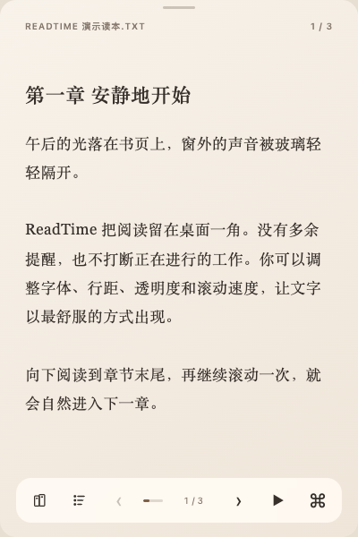
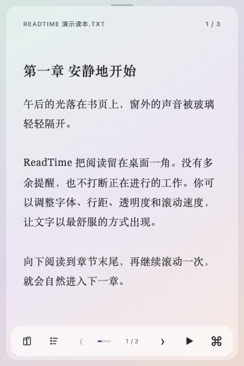
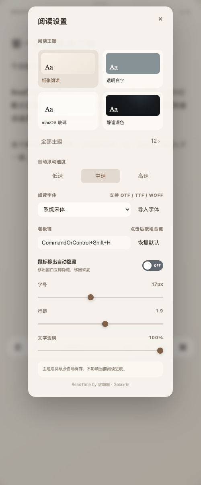

<p align="center">
  
</p>

<h1 align="center">ReadTime</h1>

<p align="center">
  一款低打扰、可快速隐藏的 macOS 与 Windows 桌面阅读工具。
</p>

<p align="center">
  基于 Tauri 2 + Rust 与 React 构建，安装包约 15 MB。
</p>

<p align="center">
  
</p>

## 核心功能

### 沉浸阅读

- 支持 TXT、EPUB，本地导入即可阅读。
- 自动识别 TXT 中文编码与章节。
- 无边框圆角窗口、窗口置顶，适合边工作边阅读。
- 自动保存书籍、章节与阅读进度，下次打开继续阅读。
- 支持添加书签，按书保存，点一下即可跳回原位。
- 记录阅读时长：今日、本周、累计与连续天数。
- 可隐藏书名，配合防截屏在公共场合也不易被看到。

### 灵活显示与快速隐藏

- 鼠标移出阅读窗口后内容瞬时隐藏，移回立刻恢复。
- 切换到其他应用时同样自动隐藏内容，不在屏幕上留字。
- 记忆窗口位置与尺寸，换屏或多屏也能放回原处，拖到屏幕边缘会自动吸附。
- 菜单栏图标可随时显示或隐藏阅读窗口，也提供「阅读设置」入口。
- 支持自定义老板键，默认 `CommandOrControl + Shift + H`。
- 窗口变窄时隐藏控制栏，只留左下角一颗圆形播放按钮；右键或长按它展开成胶囊，可选目录、书架与设置。
- 设置面板与目录、书架会按需自动撑开窗口，关闭后带动画缩回。
- 最小窗口尺寸为 `180 × 64`，窗口压得很扁也能正常阅读与控制。

### 自动滚动

- 多档滚动速度可选。
- 到达章节末尾后自动进入下一章。
- 点击控制按钮开始或暂停，自动滚动时按空格也可暂停。
- 浮动播放按钮短暂出现后自动收起，不挡阅读。

### 阅读外观

- 内置 12 套主题，包含纸张、深色、玻璃、透明和护眼风格。
- 可调整字号、行距、文字透明度与自动滚动速度。
- 支持导入本地字体。
- 切换主题只换配色，已调好的字号、行距与透明度保持不变。

### 本地书架

- 集中管理 TXT、EPUB 书籍，书名自动去掉扩展名。
- 自动记录每本书的阅读位置与书签。
- 从书架移除书籍不会删除原文件。
- 所有数据保存在本机，无需账号、无广告、无云同步。

## 界面展示

<table>
  <tr>
    <td align="center"><strong>纸张阅读</strong></td>
    <td align="center"><strong>静谧深色</strong></td>
    <td align="center"><strong>macOS 玻璃</strong></td>
    <td align="center"><strong>透明白字</strong></td>
  </tr>
  <tr>
    <td></td>
    <td></td>
    <td></td>
    <td></td>
  </tr>
</table>

<table>
  <tr>
    <td align="center"><strong>阅读设置</strong></td>
    <td align="center"><strong>本地书架</strong></td>
  </tr>
  <tr>
    <td width="55%"></td>
    <td width="45%"></td>
  </tr>
</table>

## 快捷键

Windows 上把 `Command` 换成 `Ctrl` 即可。

- `Command + ,`：打开或关闭阅读设置。
- `Command + ← / →`：切换上一章或下一章。
- `Command + = / -`：增大或减小字号。
- `Space`：暂停自动滚动。
- `CommandOrControl + Shift + H`：显示或隐藏阅读窗口，可在设置中修改。

## 下载与安装

前往 [GitHub Releases](https://github.com/galaxrin/ReadTime/releases/latest) 下载对应版本：

- Apple Silicon（M 系列芯片）：`ReadTime_1.1.0_aarch64.dmg`
- Windows 64 位：安装包目前需在 Windows 上自行构建

macOS 将 `ReadTime.app` 拖入“应用程序”后打开；Windows 运行安装程序并按提示安装。

当前安装包尚未签名。请先确认安装包来自本项目官方 Release。macOS 首次使用请右键应用并选择“打开”；如果仍被系统拦截，可执行：

```bash
xattr -dr com.apple.quarantine /Applications/ReadTime.app
open /Applications/ReadTime.app
```

请勿对来源不明的软件执行上述命令。

## 从源码构建

需要 Node.js 18+ 与 Rust 工具链。

```bash
npm install
npm run tauri:dev      # 开发调试（启动即隐藏，用菜单栏图标或老板键唤出）
npm run tauri:build    # 打包，产物在 src-tauri/target/release/bundle
npm test               # 前端单元测试
cd src-tauri && cargo test   # Rust 单元测试
```

## 作者

**脏咖喱 · [Galaxrin](https://github.com/galaxrin)**
