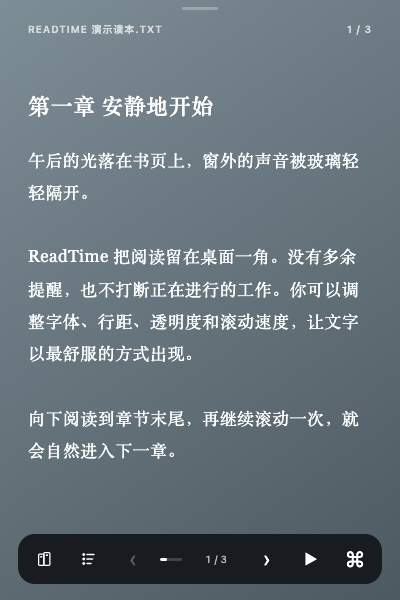
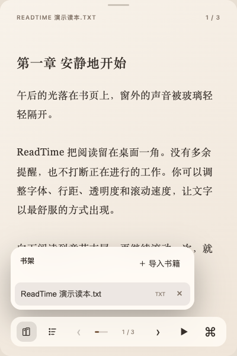

<p align="center">
  
</p>

<h1 align="center">ReadTime</h1>

<p align="center">
  一款低打扰、可快速隐藏、支持多主题的 macOS 沉浸阅读工具。
</p>

<p align="center">
  
  
  
  
  <a href="LICENSE"></a>
</p>

<p align="center">
  
</p>

## 特性

- 支持 TXT、EPUB，自动识别 TXT 中文编码与章节。
- 本地书架管理，自动恢复上次阅读位置。
- 自动滚动可选低、中、高三档速度。
- 手动阅读到章节末尾后继续向下滚动，自动进入下一章。
- 12 套阅读主题；一级设置优先展示常用主题，其余主题收纳在二级菜单。
- 可调字号、行距、文字透明度，支持导入 OTF、TTF、WOFF、WOFF2 字体。
- 无边框、置顶、透明窗口，支持鼠标移出自动隐藏。
- 菜单栏常驻与老板键快速显隐。
- 请求 macOS 内容保护，尽量避免阅读内容出现在系统截图中。

## 主题展示

<table>
  <tr>
    <td align="center"><strong>纸张阅读</strong></td>
    <td align="center"><strong>静谧深色</strong></td>
    <td align="center"><strong>macOS 玻璃</strong></td>
    <td align="center"><strong>透明白字</strong></td>
  </tr>
  <tr>
    <td></td>
    <td></td>
    <td></td>
    <td></td>
  </tr>
</table>

## 功能展示

<table>
  <tr>
    <td align="center"><strong>完整阅读设置</strong></td>
    <td align="center"><strong>本地书架</strong></td>
  </tr>
  <tr>
    <td width="55%"></td>
    <td width="45%"></td>
  </tr>
</table>

## 支持环境

- macOS
- Node.js 当前 LTS 版本
- npm

应用主要面向 macOS 菜单栏与桌面悬浮阅读场景。项目未针对 Windows、Linux 做完整适配验证。

## 本地开发

```bash
git clone https://github.com/galaxrin/ReadTime.git
cd ReadTime
npm install
npm run electron:dev
```

## 测试

```bash
npm test -- --runInBand
```

## 构建

生成生产前端与 Electron 主进程文件：

```bash
npm run build
```

仅生成当前架构的 `.app` 目录包：

```bash
npm run pack
```

产物位于 `release/`。本地目录包未配置 Developer ID 签名，首次运行时可能受到 macOS Gatekeeper 提示。

## 快捷键

| 操作 | 快捷键 |
| --- | --- |
| 显示 / 隐藏窗口 | `CommandOrControl + Shift + H` |
| 打开阅读设置 | `⌘ + ,` |
| 上一章 | `⌘ + ←` |
| 下一章 | `⌘ + →` |
| 增大字号 | `⌘ + =` |
| 减小字号 | `⌘ + -` |
| 暂停自动滚动 | `Space` |

老板键可在设置中重新录入；快捷键冲突时保留原设置。

## 项目结构

```text
ReadTime/
├── assets/                 # 应用图标、托盘图标与内置字体
├── docs/images/            # README 实际界面截图
├── src/main/               # Electron 主进程、书架、窗口、快捷键与菜单栏
├── src/preload/            # 安全 IPC 桥接
├── src/renderer/           # React 阅读界面、设置、主题与解析逻辑
├── electron-builder.json   # macOS 打包配置
└── package.json
```

## 隐私

- 书籍、字体、主题与阅读进度保存在本机。
- 当前项目不包含账号系统、云同步、广告或分析统计。
- 导入书籍时会将文件复制到应用本地数据目录；从书架移除不会删除原始文件。

## 作者

**脏咖喱 · [Galaxrin](https://github.com/galaxrin)**

## License

[MIT](LICENSE) © 2026 脏咖喱
