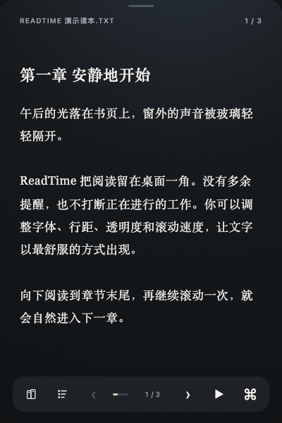

  

<h1 align="center">ReadTime</h1>

  一款低打扰、可快速隐藏、支持多主题的 macOS 沉浸阅读工具。

  

## 关于 ReadTime

ReadTime 专为桌面阅读场景设计，让阅读窗口自然融入工作环境。它拥有简洁的无边框界面，可置顶、调节透明度，也能在需要时快速隐藏，帮助你在阅读与其他事务之间轻松切换。

书籍、字体、主题和阅读进度均保存在本机，无需账号，也没有广告、云同步或分析统计。

## 功能亮点

- 支持 TXT、EPUB，并可自动识别 TXT 中文编码与章节。
- 本地书架自动保存阅读进度，再次打开即可继续阅读。
- 提供自动滚动及多档速度，章节结束后可自然衔接下一章。
- 内置 12 套阅读主题，满足纸张、深色、玻璃和透明等不同阅读场景。
- 可自由调整字号、行距和文字透明度，并支持导入常用字体。
- 支持窗口置顶、鼠标移出自动隐藏、菜单栏常驻和老板键快速显隐。
- 支持快捷键翻页、调整字号和暂停自动滚动。
- 提供 macOS 内容保护，尽量避免阅读内容出现在系统截图中。

## 主题展示

<table>
  <tr>
    <td align="center"><strong>纸张阅读</strong></td>
    <td align="center"><strong>静谧深色</strong></td>
    <td align="center"><strong>macOS 玻璃</strong></td>
    <td align="center"><strong>透明白字</strong></td>
  </tr>
  <tr>
    <td></td>
    <td></td>
    <td></td>
    <td></td>
  </tr>
</table>

## 功能展示

<table>
  <tr>
    <td align="center"><strong>阅读设置</strong></td>
    <td align="center"><strong>本地书架</strong></td>
  </tr>
  <tr>
    <td width="55%"></td>
    <td width="45%"></td>
  </tr>
</table>

## 作者

**脏咖喱 · [Galaxrin](https://github.com/galaxrin)**
